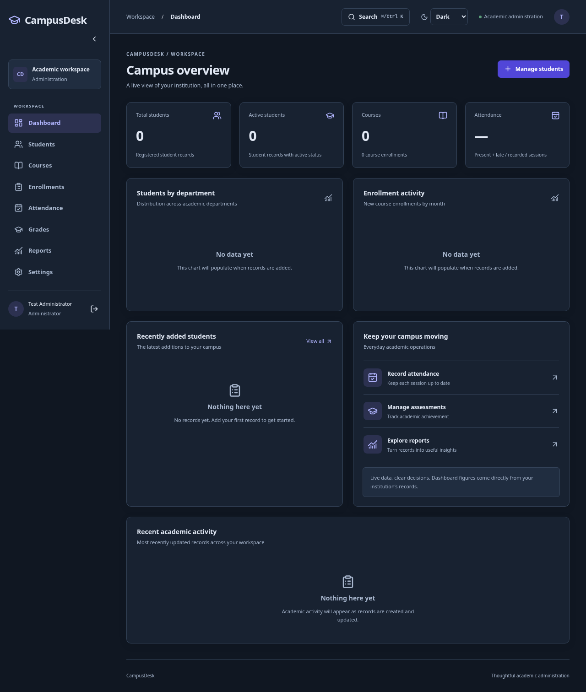

# CampusDesk

Academic administration built with React + Vite, Express, and MongoDB Atlas.
One monorepo, two deployable services: `frontend/` (Vercel) and `backend/` (Render).

## Cloud development

Open this repository in GitHub Codespaces. The dev container installs Node 24 and dependencies and forwards 5173 and 5000. No software on your laptop is required.

1. Run `npm ci --prefix backend && npm ci --prefix frontend`.
2. Copy `backend/.env.example` to `backend/.env`. Supply a real Atlas URI and a cryptographically random JWT secret of at least 32 characters through cloud secret management. Set `ADMIN_EMAIL`, `ADMIN_PASSWORD` (12–128 characters), and `ADMIN_NAME` for initial provisioning.
3. From `backend/`, run `npm run admin:init`. Existing administrators and passwords are preserved.
4. From the repository root, run `npm run dev` to start both services. Ctrl+C stops both; if either exits, the other stops too. The frontend refuses a busy port instead of silently switching ports. Restart the command after backend source changes; frontend hot reload remains enabled. Individual `npm run dev` commands in each service still work.
5. Verify `/api/health` returns HTTP 200 with `database: connected`, then sign in.

For Codespaces, set `CORS_ORIGINS` to the exact forwarded frontend origin if you call the backend directly. The default Vite proxy uses relative `/api` requests. Keep ports private.

### Isolated local cloud demo

Without Atlas, `npm run dev:local` in `backend/` starts a real MongoDB subprocess managed by mongodb-memory-server. Supply `ADMIN_EMAIL` and `ADMIN_PASSWORD` as environment variables. Set `DEMO_DATA=yes` explicitly to add fictional records. This development-only process requires access to `fastdl.mongodb.org` to download MongoDB with MD5 verification enabled. Persistent local data is stored at `LOCAL_DB_PATH` (default `/tmp/campusdesk-local-db`); this is not cloud storage or production persistence. The ephemeral signing secret invalidates sessions on restart.

### Demo data in an explicit development database

From `backend/`, run `CONFIRM_DEMO_SEED=yes npm run seed` with a non-production `MONGODB_URI`. This creates 36 fictional students, six courses, 72 enrollments, 360 attendance records, and 72 assessments, idempotently. Administrator initialization is separate. Normal startup never seeds demo data. Never seed a real institution's database.

## Capabilities

- Administrator authentication, 15-minute in-memory bearer sessions, session invalidation, password changes, login rate limiting.
- Validated student and course CRUD, search, filters, sorting, pagination, profiles, explicit deletion confirmation.
- Compatible academic-term enrollments, editable attendance registers, marks and configurable grade thresholds.
- MongoDB aggregation dashboard, department/year/enrollment/attendance/performance reports, authenticated CSV exports.
- Responsive navigation, accessible labeled forms, native modal dialogs, loading, empty, and API error states.

Missing attendance does not count as absent. Present and late both count as attended. Grade percentages are marks / maximum; aggregate performance is weighted by maximum marks. No GPA is calculated.

## Verification and deployment

- [Architecture and data rules](docs/ARCHITECTURE.md)
- [Tests and verification evidence](docs/TESTING.md)
- [Atlas, Render, and Vercel deployment](docs/DEPLOYMENT.md)
- [Implementation progress and remaining blockers](docs/PROGRESS.md)

The implementation is not yet certified complete: cloud MongoDB download access still blocks integration execution, and Atlas/hosting credentials are absent in this instance (the user previously verified Atlas in Codespaces). See the progress log for exact executed checks. No services have been deployed.

## CampusDesk 2.0 recovery milestone

Continue on `campusdesk-implementation`; PR #1 remains the review destination. No project regeneration or database migration was performed.

- Light, dark, and system themes cover the existing workspace, login, forms, tables, reports, and chart styling. Selection persists in this browser; authentication stays memory-only.
- Use the header search or Ctrl/Cmd+K to search students and courses with bounded server queries or jump to a page. Course results open a filtered directory.
- Collapse the desktop sidebar using its arrow; icon links retain accessible names and tooltips.
- Filter student/course directories by semester and clear filters together. Dirty academic forms require confirmation before discarding edits.
- Expired CSV downloads now end the session consistently. Delayed unauthorized responses from an old login cannot expire a new session.

Actual application screenshot from the browser regression run with explicitly mocked empty API responses. It demonstrates layout and theme rendering, not Atlas data or authenticated database persistence.

[Engineering case study](docs/CASE_STUDY.md) · [Current feature and verification matrix](docs/PROGRESS.md)

### Restart and demonstrate

Configure `backend/.env` privately or inject the backend variables into the shell that launches the root command, then run `npm run dev`. Secrets exported in another terminal are not inherited. Keep forwarded ports private. Check `/api/health`, sign in, change themes, open workspace search, inspect academic modules, and export an existing report. A reload requires sign-in again by design.

For isolated development only, root `npm run dev:local` runs the local MongoDB runner and frontend together. Explicit synthetic `ADMIN_EMAIL` and `ADMIN_PASSWORD` are required. Never supply production credentials or set demo seeding against Atlas. See [testing](docs/TESTING.md) for the infrastructure prerequisite.

If npm's default cache is not writable, append `--cache /tmp/campusdesk-npm` to installation commands. Integrity and TLS checks stay enabled.
