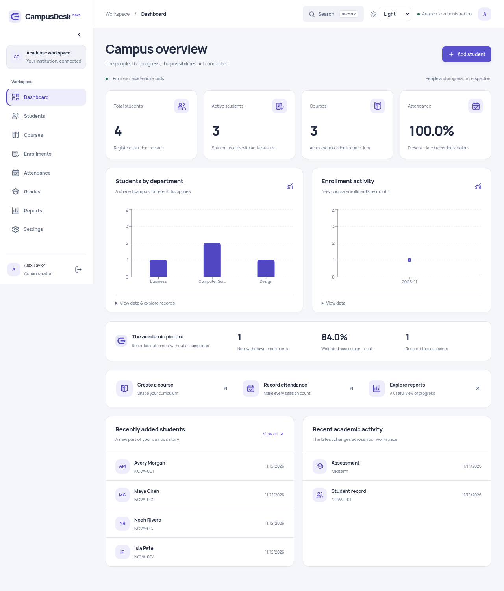

<p align="center">
  
</p>

<h1 align="center">CampusDesk</h1>
<p align="center"><strong>A connected workspace for academic administration.</strong></p>
<p align="center">Students · Courses · Enrollments · Attendance · Assessments · Reports</p>

<p align="center">
  <a href="https://campusdesk-nova.vercel.app">Live application</a> ·
  <a href="docs/FSWD_CASE_STUDY.md">FSWD case study</a> ·
  <a href="docs/EXTERNAL_DEMO.md">External demo guide</a> ·
  <a href="docs/ARCHITECTURE.md">Architecture</a> ·
  <a href="docs/spectrum/TESTING.md">Test evidence</a>
</p>

> **Hosted demo:** The existing CampusDesk production URL has been observed displaying **4.0 Spectrum Edition** in Settings and loading student records. The exact current Vercel/Render production commits and end-to-end functionality should still be checked before treating the environment as fully verified. The release source is maintained on `feature/nova-4-experience-lab`.

## Overview

CampusDesk is a full-stack student information and academic management application developed as an individual Full Stack Web Development project. It replaces fragmented spreadsheet-based workflows with an administrator-facing interface backed by authenticated APIs and consistent academic relationships.

| Area | Implemented workflow |
| --- | --- |
| Dashboard | Database-driven summaries, actions, charts and workspace search |
| Students and courses | Validated records, search, pagination, profiles and course rosters |
| Enrollments | Academic compatibility checks and searchable entity pickers |
| Attendance | Individual and atomic batch recording with conflict detection |
| Assessments | Marks, weighted results and configurable grade boundaries |
| CSV import | Drag-and-drop, column mapping, validation preview and atomic import |
| Reports | Filtered academic analysis and safe authenticated CSV exports |
| Interface | Responsive layouts, keyboard support, light/dark/system themes and unsaved-work protection |

## Screenshots

Screenshots in the original project gallery show *fictional* test records, not real student information.



For screenshot sources, data provenance and additional views, see [SCREENSHOTS.md](docs/SCREENSHOTS.md).

## Technology

| Frontend | API | Database | Verification |
| --- | --- | --- | --- |
| React 19, Vite, React Router | Node.js, Express 5 | MongoDB, Mongoose | Node tests, Playwright, isolated MongoDB |
| TanStack Query, React Hook Form, Zod | Validation, auth middleware, service layer | Unique indexes, aggregation and transactions | Desktop/mobile browser checks |
| Recharts, accessible UI components | JWT administration, request controls | Academic relationship guards | Controlled performance observations |

```text
Browser (React / Vite)
        │ HTTPS + in-memory bearer session
        ▼
Express REST API (single instance)
        │ controllers · validation · domain services
        ▼
MongoDB (Atlas for hosting / disposable MongoDB for local review)
```

A single API instance is an explicit integrity constraint. Do not scale the backend horizontally without revisiting distributed write coordination and transaction semantics.

## Run the isolated prototype

**Requirements:** Node.js 24, Docker, available localhost ports 5000 and 5173.

```bash
npm ci
MONGOMS_DISABLE_POSTINSTALL=1 npm ci --prefix backend
npm ci --prefix frontend
node scripts/nova4-preview.js
```

Open **http://127.0.0.1:5173** after the launcher reports readiness. The launcher creates a **disposable test database containing fictional records** and is intended for controlled review, **not** for persistent use or connection to Atlas. The review credentials and details are in [the local-review guide](docs/nova4/REVIEW.md). Shutting down the launcher removes its owned disposable data.

## Testing

Run all checks against an **owned isolated** database rather than a production MongoDB URI:

```bash
PLAYWRIGHT_CHROMIUM_EXECUTABLE_PATH=/usr/bin/chromium npm run verify:isolated
```

The Spectrum verification report dated **17 November 2026** records **151 passing checks**: 67 backend, 42 frontend, 2 supervisor and 40 Chromium desktop/mobile browser cases. The feature commit `4f55aad` also completed a successful GitHub Actions workflow. These are **controlled test-environment results**, not production uptime, latency, browser-compatibility or accessibility certification.

- [Implementation details](docs/spectrum/IMPLEMENTATION.md)
- [Verification record](docs/spectrum/TESTING.md)
- [Performance observations](docs/spectrum/PERFORMANCE.md)
- [Deployment and rollback considerations](docs/DEPLOYMENT.md)

## Release and deployment

The existing production checkout and the Spectrum experimental release are intentionally separate:

| Branch | Purpose |
| --- | --- |
| `main` | Repository default / initial README; not the current application source |
| `campusdesk-implementation` | Previous working implementation / production baseline |
| `feature/nova-4-experience-lab` | Latest Spectrum 4.0 source and FSWD documentation |

**Hosting design:** Vercel for the frontend, Render for one Express API instance and MongoDB Atlas for persistent storage. Environment secrets must be kept in the hosting dashboards, never in Git. Before promoting Spectrum, verify the exact hosted commit, frontend API origin, backend CORS, Atlas replica-set capabilities, live health endpoint and key workflows with *fictional* temporary records. Preserve a rollback path to `f5752a7`.

See [DEPLOYMENT.md](docs/DEPLOYMENT.md) for environment configuration and detailed deployment requirements. The hosted site has been observed showing the 4.0 interface; confirm exact deploy commit in hosting dashboards before announcing a release.

## Academic project

**CampusDesk — Design and Development of a Full-Stack Student Information and Academic Management System**

- **Student:** P. Sai Shishir — A24126552105
- **Subject:** Full Stack Web Development (`23CM4121`)
- **Guide:** Mr. P. Santosh Kumar
- **Department:** CSE (AI & ML), ANITS
- **Academic year:** 2026–2027
- **Project:** Individual

[Read the individual FSWD case study](docs/FSWD_CASE_STUDY.md) · [External examination demo guide](docs/EXTERNAL_DEMO.md).

## Scope and limitations

The documented build provides administrator-facing academic functions. It does **not** claim faculty/student role-based access, multi-institution tenancy, public registration, immutable audit-event history, email-based recovery, offline academic write support or verified production performance. Authentication sessions are intentionally short-lived and memory-only; refreshing the page requires sign-in again. Technical tradeoffs and planned enhancements are described in the engineering notes.

---

<sub>CampusDesk · Individual FSWD academic project · ANITS · 2026–2027</sub>
