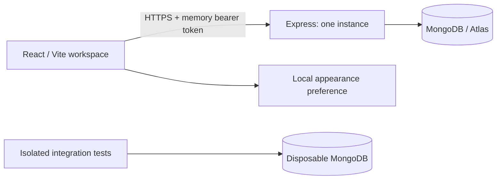

<picture>
  <source media="(prefers-color-scheme: dark)" srcset="frontend/public/brand/logo-dark.svg">
  
</picture>

# CampusDesk Nova

A connected workspace for student records, courses, enrollment, attendance, assessments, and academic reporting. React/Vite on Vercel, one Express API on Render, MongoDB for persistent records.


**Screenshot disclosure:** the dashboard above and original Nova gallery use fictional API-contract fixtures. The new Phase II gallery shows actual workflows backed by disposable local MongoDB. Neither gallery involves Atlas. Fixtures are confined to browser tests and never used by the application.

## The workspace

- An original courtyard-C identity, custom SVG navigation and editorial illustrations, and self-hosted Manrope typography.
- Light, dark, and live system appearance; selective glass navigation/search, solid record surfaces, reduced-motion and reduced-transparency support.
- Keyboard workspace search (Ctrl/Cmd+K, arrows, Enter, Escape), a collapsible sidebar, and a focus-managed mobile drawer.
- Database-driven dashboard metrics, weighted assessment results, accessible chart data, and contextual actions.
- Validated student/course CRUD, searchable academic selectors, server pagination, mobile record cards, student history, and paginated course rosters.
- Individual and atomic bulk attendance with an eligible course roster, review, conflict detection, and safe retries.
- Validated student CSV upload, column mapping, read-only preview, atomic confirmation, and retry receipts.
- Assessment management, grade thresholds, five filtered report categories, and authenticated spreadsheet-safe CSV exports.
- Explicit administrator provisioning, 15-minute memory-only bearer sessions, logout/password revocation, exact-origin CORS, rate-limited login, and protected academic relationships.

Phase II verifies academic persistence against owned disposable MongoDB, including authenticated browser journeys. Atlas was never accessed. Bulk operations require a replica set; the API remains a single instance. Durable audit history, faculty roles, PWA/offline behavior, and PDF export are deferred. [Phase II delivery report](docs/NOVA_PHASE_II.md) · [original Nova design delivery](docs/NOVA_DELIVERY.md).

## Run in Codespaces or a cloud workspace

Use Node 24. This environment is already isolated; use the existing checkout.

```sh
npm ci
npm ci --prefix backend
npm ci --prefix frontend
npm run dev
```

Before starting, configure `backend/.env` from `.env.example`, or inject variables into the shell launching the root command. Required: `MONGODB_URI` and a cryptographically random `JWT_SECRET` of at least 32 characters. Never commit credentials or print their values. Secrets exported in another terminal are not inherited.

The root command starts Express on 5000 and Vite on 5173. Ctrl+C stops both process groups; if either service exits, its sibling stops. Vite refuses a busy port. Frontend hot reload works; restart the root command after backend changes. Individual service `npm run dev` commands remain available. Keep forwarded ports private.

Provision administrators explicitly using `npm run admin:init --prefix backend` with securely supplied `ADMIN_EMAIL`, `ADMIN_PASSWORD` (12–128 characters) and `ADMIN_NAME`. Existing administrator passwords are preserved. Startup never seeds or provisions automatically.

### Isolated development and tests

Root `npm run dev:local` starts a disposable/local MongoDB runner and frontend. Supply **synthetic** `ADMIN_EMAIL` and `ADMIN_PASSWORD`, and an isolated `LOCAL_DB_PATH`. `DEMO_DATA=yes` explicitly enables fictional seed records in that local database. It never uses the Atlas URI. Local data directories are not cloud persistence.

The original memory-server download remains denied by this cloud proxy. The verified alternative uses an official, digest-pinned MongoDB Docker container, loopback-only port and disposable storage. It never reads `MONGODB_URI` and cleans up only its own generated test databases/container. TLS and integrity verification remain enabled.

```sh
# Docker daemon + Node 24 + installed Chromium required
PLAYWRIGHT_CHROMIUM_EXECUTABLE_PATH=/usr/bin/chromium npm run verify:isolated
```

This command runs backend, frontend, supervisor, build, and desktop/mobile browser checks with generated synthetic credentials. See the [isolated interactive demo](docs/NOVA_PHASE_II.md#isolated-interactive-demonstration) for hands-on use without Atlas.

```sh
npm run test:dev
npm test --prefix backend
npm test --prefix frontend
npm run build
PLAYWRIGHT_CHROMIUM_EXECUTABLE_PATH=/usr/bin/chromium npm run test:e2e --prefix frontend
```

If npm's default cache is not writable, append `--cache /tmp/campusdesk-npm` to installation commands. A browser binary may need installation on other machines. See [testing](docs/TESTING.md) for real database versus fixture test boundaries.

## Architecture and data policy



Academic relationships must match department, semester, academic year and term. Database indexes prevent duplicate identifiers and academic records. Dependent history blocks parent deletion; there are no destructive cascades. Present and late count as attended; missing sessions are excluded. Weighted results use total marks / total maximum marks. No GPA is inferred.

**Run exactly one API instance.** Relationship-sensitive writes are serialized in one process; multi-instance or external concurrent writers require a transaction-aware coordination design before scaling. Refresh requires sign-in again by design; no authentication tokens enter localStorage.

## Engineering notes

- [Phase II functional delivery, verification, API policies and demo guide](docs/NOVA_PHASE_II.md)
- [Original Nova design delivery](docs/NOVA_DELIVERY.md)
- [Screenshot gallery](docs/SCREENSHOTS.md)
- [Architecture](docs/ARCHITECTURE.md)
- [Testing](docs/TESTING.md)
- [Deployment: Atlas → Render → Vercel](docs/DEPLOYMENT.md)
- [Progress](docs/PROGRESS.md)
- [Case study](docs/CASE_STUDY.md)

Render and Vercel configurations are preserved. No public deployment or production verification is claimed. PR #1 stays the review destination on `campusdesk-implementation`. Font attribution and OFL license are shipped in `frontend/public/licenses`; brand source is in `frontend/src/components/Brand.jsx`.
