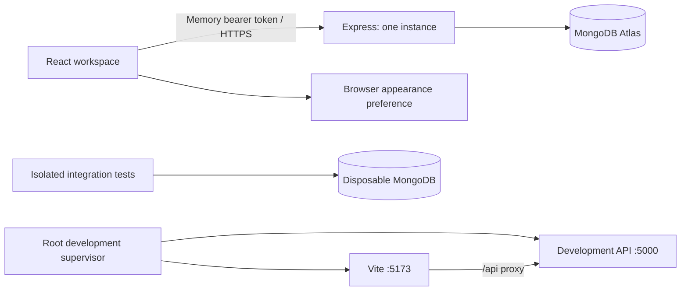

# Architecture

React 19 / Vite frontend uses TanStack Query for server state, React Hook Form + Zod for input, Lucide for icons, Recharts (lazy loaded) for database-driven charts, Tailwind CSS and shared CSS for the component system. Native HTML dialogs supply focus containment and Escape dismissal without an additional UI toolkit. React Router handles SPA navigation. Refresh intentionally requires signing in again: bearer tokens exist only in memory, expire after 15 minutes, and never enter localStorage or URLs.

Express 5 REST API separates Mongoose models, Zod validators, authentication middleware, integrity services, controllers, and aggregation services. All API operations except health and login require an administrator JWT with issuer/audience checks and a database token-version check. Logout and password changes revoke all sessions for that administrator.

MongoDB is the only application record store. Production uses Atlas. Development tests use a real isolated mongod subprocess, not a mock API or mock database. Health returns 503 unless Mongoose is connected. Server waits for database connection and unique indexes before listening. Server shutdown closes HTTP and MongoDB resources.

## Data constraints

- Students: unique student ID, roll number, normalized email; indexed department/year/status.
- Courses: unique uppercase code.
- Enrollments: unique student/course/academic term. Department, semester and academic year must match. Term equals course academic year. Active enrollment requires an active student.
- Attendance: unique student/course/ISO calendar date; an active or completed enrollment is required. No implicit absence rows are generated.
- Grades: unique student/course/term/assessment, positive maximum, marks in [0, maximum]. Assessment percentages and configurable per-administrator grade labels are returned by the API.
- Dependencies block parent deletion and incompatible academic field edits. Remove child records first; there is no destructive cascade.
- Enrollment removal, reassignment or withdrawal is blocked while academic records depend on it.

Integrity-sensitive API writes are serialized in this single-process deployment. **Render must run one API instance.** Multiple instances or external concurrent writers require transaction-aware shared locking before scaling. Database unique indexes remain authoritative for duplicates. Administrator/demo scripts are explicit operational tools, not concurrent production writers.

List endpoints use database pagination (default 20, maximum 100), whitelisted sorts and filters, and escaped literal regex search. Student history returns at most 500 records per category, clearly disclosed in the UI; attendance percentage uses all records. Report aggregates read all matching database records. CSV cells escape quotes and formula prefixes.

## API surface

- GET /api/health
- POST /api/auth/login
- GET /api/auth/me
- POST /api/auth/logout
- POST /api/auth/password
- PUT /api/auth/thresholds
- GET, POST /api/{students,courses,enrollments,attendance,grades}
- GET, PUT, DELETE /api/{collection}/:id
- GET /api/students/:id/history
- GET /api/reports
- GET /api/reports/{departments,years,courseEnrollments,attendance,performance}.csv

PUT replaces all validated editable fields. Invalid input returns 422, conflicts 409, absent resources 404, authentication failures 401. Invalid query values can return 400. JSON body limit is 100 KB (160 KB for the bounded CSV import envelope). Unknown fields are rejected. No public admin registration exists. CORS accepts only exact configured origins. Helmet provides security headers. Authorization headers, request bodies and credential values are excluded from request logs.

Operational limitations: no audit-event collection (dashboard activity shows latest updates to actual records, not an immutable historical audit log); no multi-institution tenancy; no timezone inference for attendance dates (explicit YYYY-MM-DD); no refresh-token session recovery; no automated production database migrations or backups. Use Atlas backups and operational monitoring before institutional use.

## Workspace presentation and development supervision

`components/Theme.jsx` owns browser appearance preferences; an early HTML bootstrap sets the resolved theme before the application loads. CSS semantic tokens style existing components and chart SVGs. System-mode subscriptions are removed on cleanup; denied localStorage access falls back to an in-session choice. This storage contains appearance only, never bearer tokens.

Shared native dialogs, messages, loading and empty states live in `components/Feedback.jsx`. Dialog cancel events are prevented until the owning form approves closure, so declining discard also works with Escape. Nova now extracts feature pages under features/ with lazy route boundaries; forms can be split further as workflows grow.

`components/GlobalSearch.jsx` queries authenticated student/course list endpoints after a 250ms debounce with a six-record limit per category. No complete database is preloaded. Search results navigate to student profiles or a code-filtered course directory; page shortcuts use real routes.

The API client bounds requests to 30 seconds and handles authentication failures for JSON and CSV consistently. It compares a request's captured token to the current in-memory token before expiring a session, protecting subsequent logins from stale responses.

Root `scripts/dev.js` starts service process groups, propagates failures, and terminates siblings/descendants on shutdown. It starts the backend without watch mode to detect startup failures reliably; individual backend watch mode is preserved. It never provisions administrators or seeds Atlas.

## Nova feature architecture

The React bootstrap is now `frontend/src/entry.jsx`; `main.jsx` contains the authenticated shell and lazy route boundaries, with the shared QueryClient in `queryClient.js`. Login, Dashboard, Records/forms, StudentProfile, CourseProfile, Reports and Settings live under `features/`. `WorkspaceUI`, `Feedback`, `MobileRecord`, `Brand`, `Theme`, `GlobalSearch` and `LazyChart` provide shared presentation.

`styles/tokens.css` owns semantic theme, elevation, typography and motion values. `styles.css` composes layouts and controls. Manrope Latin variable WOFF2 is self-hosted from the pinned Fontsource dependency; its OFL license ships with the application. No external font request, new animation engine or third-party glass/refraction implementation is used.

Glass is progressive enhancement on navigation/search/quick actions only, using bounded backdrop blur and high-opacity surfaces. Unsupported browsers retain solid backgrounds. Reduced transparency removes blur; reduced motion removes nonessential animation. Charts do not animate changing academic values. Tables and long forms stay opaque.

Course profiles reuse GET /courses/:id and the existing paginated enrollment list; no schema or backend endpoint changed. Mobile record cards expose the same edits/deletions as desktop tables. Student history and report selection are local presentation state over real API results. Dashboard weighted results sum marks and maximum marks, rather than averaging percentages.

The browser visual fixtures live only under e2e/fixtures and are not part of the production import graph. No service worker or sensitive-record cache was introduced. The single-instance integrity contract and memory-only authentication remain unchanged.

## Phase II: transactional academic workflows

Nova's identity, memory-only sessions and original CRUD contracts remain. `features/AttendanceRegister.jsx` and `StudentImport.jsx` are lazy routes; capability discovery only exposes their entry links when MongoDB reports replica-set/sharded transaction support. Unsupported writes return a clear 503 rather than a non-atomic fallback. Original individual CRUD remains available.

All relationship-sensitive writes use the existing process queue. `services/transactions.js` additionally wraps batch writes in a snapshot/majority MongoDB transaction. Queries within transactions run sequentially, with one attendance `bulkWrite` or bounded student `insertMany`. This does **not** remove the single-instance contract or make external writers safe.

Attendance adds a nonnegative `revision` (legacy missing revisions are read as zero). Register reads are paginated, use one roster aggregation plus one page attendance lookup, and verify academic compatibility. Bulk submissions require each row's expected revision (null for a new record), reject all rows on conflict/ineligibility, and increment revisions on changes. Individual PUT also increments revision. An identical desired status is an explicit no-op, including stale retries, and never changes timestamps. Missing rows are not absences.

Student imports parse bounded UTF-8 CSV with `csv-parse`, map actual schema fields, require explicit ignored columns, validate every row and internal/existing unique conflicts, and provide a read-only preview digest. Confirmation rechecks everything in a transaction and creates new students only. `OperationReceipt` records actor, UUID request ID, SHA-256 digest, generated IDs/count and creation date in that same transaction. Unique actor/request ID plus a seven-day TTL supports retry without storing CSV bodies. Identical replay returns the original result; different content under the same key conflicts. After receipt expiry, unique student indexes still reject duplicates. An all-invalid or partially invalid import writes nothing.

New additive indexes: course department/year/semester; enrollment course/term/status/student; attendance course/date/student; grade course/term; receipt actor/request ID unique and createdAt TTL. All preexisting unique and relationship indexes are retained. `model.init()` creates indexes at startup; there is no `syncIndexes`, drop, production migration, or Atlas access in this task.

### Additional authenticated routes

| Method | Path | Contract |
| --- | --- | --- |
| GET | /api/operations/capabilities | Actual transaction support and batch limits |
| GET | /api/attendance/register | Course/date, page (default 1), limit (default 25, max 100) |
| POST | /api/attendance/bulk | Course/date, 1–100 unique student/status/expectedRevision rows |
| GET | /api/students/import/template.csv | Headers only; no fabricated defaults |
| POST | /api/students/import/preview | CSV, optional mapping and explicit ignored columns; no writes |
| POST | /api/students/import | Same content plus confirm=true, previewDigest and UUID requestId |

Report JSON/CSV accept the same strict optional department, academicYear, semester, course, term, dateFrom and dateTo filters. Academic fields match exactly; course or term restricts student distributions to non-withdrawn enrollments. Term matches enrollment/assessment term and course year. Dates are inclusive and apply only to recorded attendance; missing sessions stay excluded. Five explicit CSV schemas include headers even for empty reports and escape formula prefixes (including leading whitespace), quotes, delimiters and Unicode. Unknown export types are rejected before aggregation.

The dashboard's recent updates remain a projection of record updatedAt values, **not** a durable audit trail. Dependable audit across legacy standalone CRUD is deferred rather than introducing success events that could outlive failed writes.
